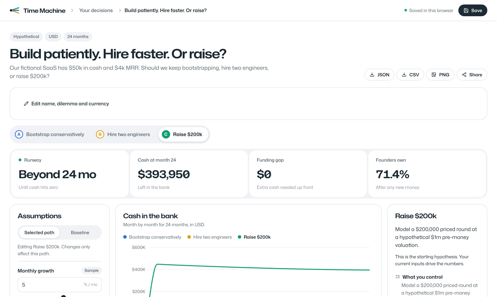
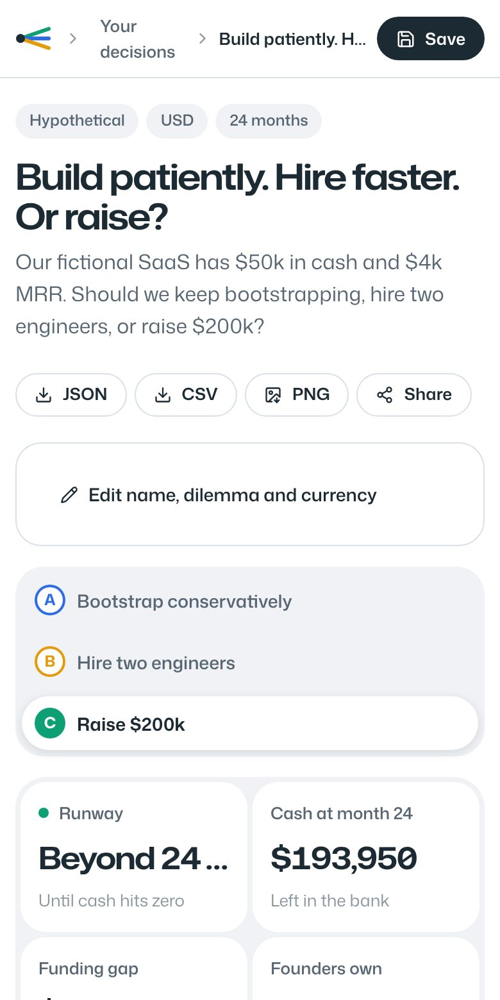
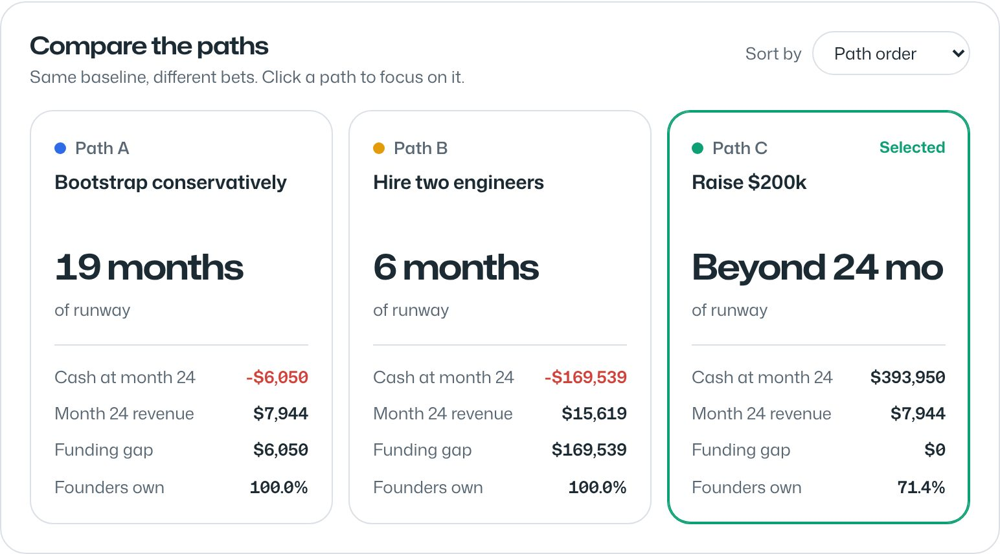
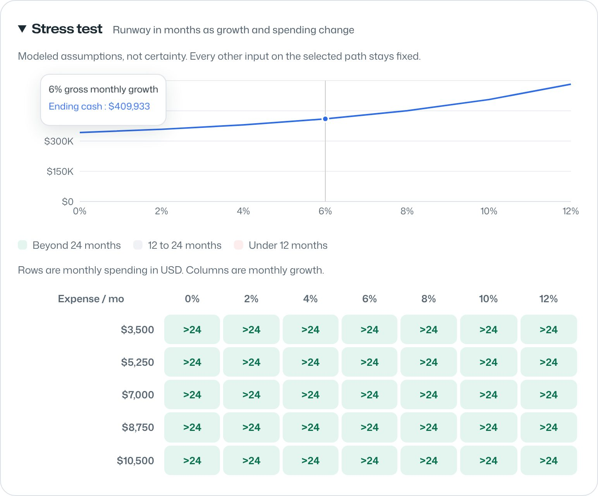

# Time Machine

**Hire, raise or stay lean. See the next 24 months first.**

Time Machine models cash, runway and founder ownership for three paths at once. Change a
number and every chart redraws on the spot. It runs entirely in your browser: no account,
no bank login, no API key. Everything it shows is a "what if" model, not a forecast and
not financial advice.


## What it looks like

All of these are real screenshots. `tests/e2e/screens.spec.ts` opens the app, clicks through
the demo and saves them, so they always match the code.

| The workspace | On a phone |
|---|---|
|  |  |

| Compare the paths | Stress test |
|---|---|
|  |  |

## Run it locally

You need **Node.js 22.12 or newer** and npm. Nothing else: no database, no paid service.

```sh
git clone https://github.com/marpusakethram/Timemachine.git
cd Timemachine
npm ci
npm run dev
```

Open **http://127.0.0.1:3000** and click **Open the fictional SaaS demo**. Then:

1. Pick **Raise $200k** (path C) in the path switcher.
2. Move **Capital raised** from 200,000 to 400,000.
3. Watch the green cash line go up and **Founders own** drop from **83.3% to 71.4%**.
4. Switch to path A or B to compare, hit **Save**, reload, and it's still there.
5. Export **JSON** or **CSV** from the buttons next to the title.

The demo makes zero network calls. Save writes to this browser's localStorage. Export JSON
if you want a backup or want to move a scenario to another computer.

Production build:

```sh
npm run build
npm start
```

Both commands bind to 127.0.0.1 only. You need internet to install packages, but after that
the app works fully offline.

## What's in it

- One decision with three paths: **A** bootstrap, **B** hire, **C** raise.
- A 24 month model of revenue, costs, cash, runway, funding gap and dilution.
- A headline strip with the four numbers that matter for the selected path.
- Inputs for cash, revenue, expenses, margin, growth, churn, customers, funding, valuation,
  ownership, one-time capex and a hiring cost. Each shows its unit, its limits, a default
  and where the number came from (sample, entered or inferred).
- Baseline values flow into every path unless that path overrides them. Reset any path back.
- A stress test chart and a growth by spending runway grid.
- JSON import and export, a monthly CSV, a PNG snapshot and small share links.
- Optional Gemini suggestions with consent and a review step. Your own edits always win.
- Keyboard friendly, responsive down to phone width, respects reduced motion.

## Commands

| Command | What it does |
|---|---|
| `npm run dev` | Dev server at http://127.0.0.1:3000 |
| `npm run build` | Production build |
| `npm start` | Serve the production build |
| `npm run typecheck` | TypeScript, no emit |
| `npm run lint` | ESLint with the Next.js config |
| `npm test` | Unit and integration tests (Vitest) |
| `npm run test:e2e` | Browser tests (Playwright). Also refreshes screenshots |
| `npm run check` | Typecheck, lint, unit tests and build in one go |
| `node scripts/audit-licenses.mjs` | Rebuild the third-party license list |

Before the first `npm run test:e2e`, run `npx playwright install chromium` once.

## When things go wrong

| What you see | Why | What to do |
|---|---|---|
| "This scenario isn't in this browser" | Scenarios live in the browser that made them | Export JSON on the old device, then **Import JSON** on the new one |
| "Invalid or oversized JSON" on import | The file isn't a Time Machine v1 export, or it's over 100 KB | Export again from the app. Nothing on your side was overwritten |
| "Local library is full (50 scenarios)" | You hit the 50 scenario limit | Export and delete an older scenario, then save again |
| "Saved data is corrupt" | Browser storage was edited or damaged | Import a JSON backup, or clear this site's storage |
| "Gemini is not configured" or "API calls are disabled" | No key, or the free model checks aren't set (this is the default) | Ignore it, or follow the Gemini setup below. Everything else still works |
| "Local daily request budget reached" | The 10 requests per UTC day budget is used up | Wait for the next UTC day. Don't delete `.data/quota.json` to get around it |
| "Quota ledger is busy or locked" after a crash | A leftover `.data/quota.lock` folder | Stop every app process, then delete only that empty lock folder |
| PNG export fails | The browser blocks canvas capture | Take a normal screenshot or export JSON |
| Share link opens nothing on another machine | The link points at `localhost` | Swap the start of the URL for the other person's app address |
| `npm run test:e2e` can't find a browser | Playwright's Chromium isn't installed | Run `npx playwright install chromium` |

## Optional Gemini setup (off by default)

1. Copy `.env.example` to `.env.local`.
2. Use a Gemini project **with billing turned off**. Don't turn billing on for this app.
3. Check for yourself that your model has **free tier input and output** on
   [Google's pricing page](https://ai.google.dev/gemini-api/docs/pricing).
4. Put the exact model ID in both `GEMINI_MODEL` and `FREE_MODEL_ALLOWLIST`, and set
   `FREE_MODEL_VERIFIED_ON` to the date you checked (`YYYY-MM-DD`). It expires after 30 days.
5. Set `GEMINI_UNBILLED_PROJECT_CONFIRMED=true` for that unbilled project only, add
   `GEMINI_API_KEY`, and restart the server.
6. In the workspace, tick the consent box and click **Generate candidates**. Review the
   suggested numbers, tick the review box, then click **Apply reviewed candidates**.

The key stays on the server. Only the decision text and baseline numbers are sent. Free tier
inputs can be used by Google to improve its products, so don't send anything confidential.

Limits by default: **10 requests per UTC day**, **3 attempts per run**, **3,000 output
tokens**, **16 KB input**, **20 seconds per attempt**. Failed attempts count too. Good
responses are cached by a SHA-256 hash of model, prompt version and input, and cache hits
are free. The app never fakes a successful AI answer.

**Not verified live:** no Gemini key was available while building this. The connector is
tested with clearly labeled fixtures and the real "not configured" error path only.

## The math

Each month, with percentages turned into fractions:

```text
revenue[t] = revenue[t−1] × (1 + growth) × (1 − churn)
COGS[t] = revenue[t] × (1 − gross_margin)
gross_profit[t] = revenue[t] − COGS[t]
OpEx[t] = recurring_expenses + (hiring_cost if t >= hiring_month)
operating_CF[t] = gross_profit[t] − OpEx[t]
cash[t] = cash[t−1] + operating_CF[t] + financing[t] − capex[t]
investor_fraction = investment / (pre_money + investment)
founder_ownership_after = founder_ownership_before × pre_money / (pre_money + investment)
```

Runway is the first month cash hits zero or below. "Beyond 24 mo" just means cash stayed
positive for all 24 months. The funding gap is the extra cash you'd need at month zero to
stay above zero every month. It's not a suggested raise. Full rules are in
[ASSUMPTIONS.md](docs/ASSUMPTIONS.md).

## The sample numbers

The importable fixture is [fixtures/sample-saas.json](fixtures/sample-saas.json). Baseline:
50,000 cash, 4,000 monthly revenue, 7,000 monthly expenses, 80% margin, 40 customers,
5% growth, 2% churn, 1,000,000 pre-money valuation, 100% founder ownership. All made up, in USD.

Path B adds 10,000 a month from month 3 and assumes 8% growth. Path C raises 200,000 in
month 1. The model doesn't claim hiring causes growth. That's just the sample's assumption.

## What it doesn't do

- Monthly model with constant rates. No probabilities, no market data.
- One priced round. No SAFEs, option pools, liquidation preferences or later rounds.
- No receivables, taxes, debt, interest or deferred revenue.
- Browser storage only: up to 50 scenarios, no sync between devices, can be wiped by the browser.
- No accounts, teams, bank connections or payments.
- Currency switching only relabels amounts. No exchange rates.
- Share links aren't encrypted. Anyone with the link can read the scenario.
- Public hosting isn't set up. If you host it, keep Gemini off unless access is restricted.

## How it's built


Next.js 16 App Router, React 19, TypeScript, Tailwind 4, Zod, Recharts and React Flow.
Mona Sans is bundled through Fontsource, so there are no remote font calls. The math engine
has no React or AI code in it. More in [ARCHITECTURE.md](docs/ARCHITECTURE.md),
[DESIGN.md](docs/DESIGN.md) and [VERIFICATION.md](docs/VERIFICATION.md).

## Contributing and license

See [CONTRIBUTING](CONTRIBUTING.md). Our code and diagram are [MIT](LICENSE). Dependencies
keep their own licenses: see the [third-party list](docs/THIRD_PARTY_LICENSES.md).
