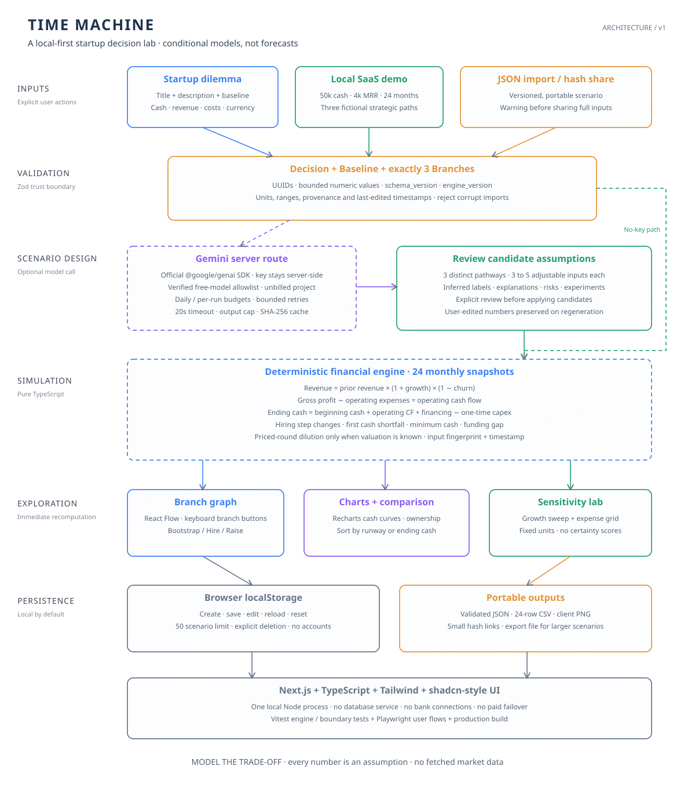
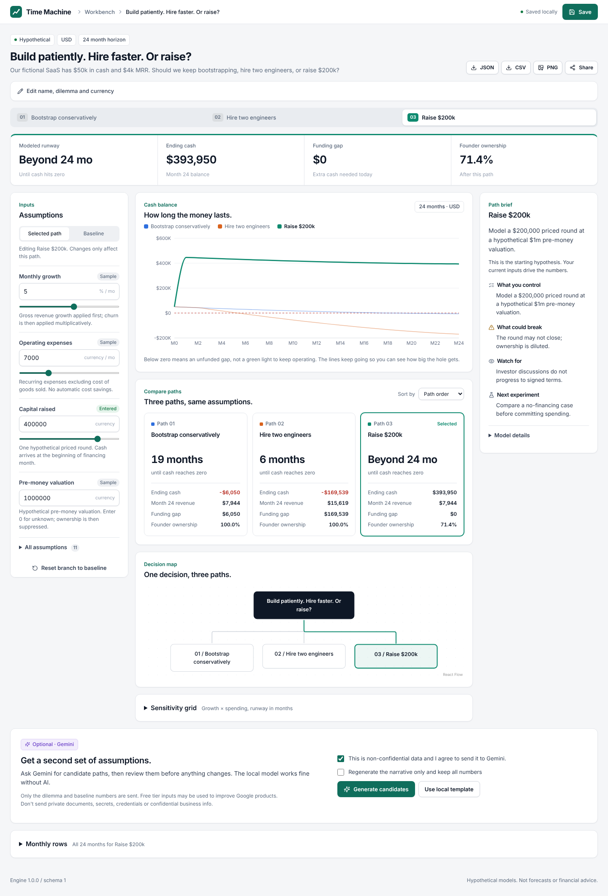

# Time Machine

**Move the assumptions. See the runway.**

Time Machine is a decision modeling tool for early-stage teams. You frame a decision,
compare three paths side by side, move a number like capital raised or monthly growth,
and watch runway, cash and founder ownership update right away.

It runs in your browser. No account, no bank login, no API key. The outputs are
"what if" models, not forecasts and not investment advice.


## Who it's for

- **Founders** deciding whether to bootstrap, hire or raise.
- **Finance and ops leads** who want a quick, honest model before building a full spreadsheet.
- **Anyone prepping a board or investor chat** who needs the trade-offs on one page.

## Get it running

You need **Node.js 22.12 or newer** and npm. That's it. No database, no paid service.

```sh
git clone https://github.com/marpusakethram/Timemachine.git
cd Timemachine
npm ci
npm run dev
```

Open **http://127.0.0.1:3000** and click **Open the fictional SaaS demo**.
The main thing to try takes under a minute:

1. Pick **Raise $200k** in the path switcher.
2. Move **Capital raised** from 200,000 to 400,000.
3. Watch the cash line go up and founder ownership drop from **83.3% to 71.4%**.
4. Flip to the bootstrap and hiring paths to compare, then export JSON or CSV.

The demo makes zero cloud calls. Hitting Save writes to your browser's localStorage.
Export JSON if you want a backup or want to move a scenario to another computer.
Everyone runs their own copy, so nobody else sees your browser data.

For a production build:

```sh
npm run build
npm start
```

The server only listens on localhost by default. You need internet to install
dependencies, but once installed the simulator works fully offline. Node is the
only thing you need at runtime, and any editor or coding agent can work on the source.

## What you get

- Create, check, edit, save, reload, delete and import decisions.
- A ready to go **Bootstrap vs raise** template, with a third path for hiring.
- Instant, repeatable math: 24 monthly rows, cash curves and a side by side comparison.
- A KPI strip for the selected path: runway, ending cash, funding gap and founder ownership.
- Inputs for starting cash, revenue, expenses, margin, growth, churn, customers, financing,
  pre-money valuation, founder ownership, one-time capex and a hiring cost step.
- Every number has units, allowed range, a default, a source tag (sample, entered or
  inferred), an explanation and a last edited time. Hover the tag to see it.
- Baseline values flow into every path unless that path overrides them. You can reset a
  path back to baseline and sort paths by runway or ending cash.
- A growth sensitivity chart plus a growth by spending runway grid.
- JSON import and export, a monthly CSV for the selected path, a PNG snapshot and small
  share links.
- Optional Gemini suggestions, with consent, a review step, and your own edits always kept.
- Keyboard friendly path buttons, a mobile layout, visible focus states and reduced motion support.
- A clean, light, B2B style interface. See the [design notes](docs/DESIGN.md).

Other starter templates stay hidden until their math is actually built.

## How it's built



[Architecture notes](docs/ARCHITECTURE.md) · [SVG source](docs/architecture.svg) ·
[PNG diagram](docs/architecture.png) · [Assumptions and equations](docs/ASSUMPTIONS.md)

Next.js App Router, TypeScript, Tailwind, a shadcn style button, React Flow, Recharts
and Zod. The Inter font ships locally through Fontsource, so there are no remote font calls.
The math engine has zero React or AI dependencies. Data lives in browser storage, so there's
no server database. The server disk is only used for the optional AI budget and cache.

## Optional Gemini setup (off by default)

1. Copy `.env.example` to `.env.local`.
2. Use a Gemini project **with billing turned off**. Don't turn billing on for this app.
3. Check for yourself that the model you want has **free tier input and output** on
   [Google's pricing page](https://ai.google.dev/gemini-api/docs/pricing).
4. Put the exact model ID in both `GEMINI_MODEL` and `FREE_MODEL_ALLOWLIST`. Nothing is
   picked for you. Set `FREE_MODEL_VERIFIED_ON` to the date you checked (`YYYY-MM-DD`).
   That check expires after 30 days.
5. Set `GEMINI_UNBILLED_PROJECT_CONFIRMED=true` only for that unbilled project, and set
   `GEMINI_API_KEY` on the server. Restart the server.
6. In the workspace, confirm the decision isn't confidential and click
   **Generate candidates**. Review or tweak the suggested numbers, then apply them yourself.

Heads up: Google says free tier availability depends on the model, and free tier inputs
can be used to improve their products. So don't send private docs, credentials, secrets
or anything confidential. The app can't reliably confirm billing status or free tier
eligibility through `models.list`, which is why you have to confirm it. That's not a
price or quota guarantee. There's no paid fallback, no browsing, no grounding and no
other AI services.

The connector uses Google's official `@google/genai` SDK with structured JSON output.
Defaults: **10 requests per UTC day**, **3 attempts per run**, **3,000 output tokens**,
**16 KB max input**, and a **20 second timeout per attempt**. Every attempt counts against
the budget, even failed ones. The SDK's own retries are off. Our local retries back off
on 429s and temporary server errors, and there's at most one schema fix retry inside the
same per-run cap.

Good responses get cached by a SHA-256 hash of model, prompt version and input. Cache hits
don't use up a request. Failures show up clearly in the UI with the local template as a
fallback. The app never fakes a successful AI answer. Test fixtures are labeled as fixtures.

`.data/quota.json` and `.data/cache/` stay local and are gitignored. A disk lock stops
multiple servers sharing that folder from blowing past the budget. If the app crashes while
holding `.data/quota.lock`, stop every app process and delete **only that empty lock
folder**. Keep `quota.json`. If the quota file is corrupt, the app fails closed. Don't
delete or swap the ledger to get around your request limit.

## The math

Each month, with percentages turned into fractions:

```text
revenue[t] = revenue[t−1] × (1 + growth) × (1 − churn)
COGS[t] = revenue[t] × (1 − gross_margin)
gross_profit[t] = revenue[t] − COGS[t]
OpEx[t] = recurring_expenses + (hiring_cost if t >= hiring_month)
operating_CF[t] = gross_profit[t] − OpEx[t]
cash[t] = cash[t−1] + operating_CF[t] + financing[t] − capex[t]
investor_fraction = investment / (pre_money + investment)
founder_ownership_after = founder_ownership_before × pre_money / (pre_money + investment)
```

We assume you collect cash in the same month you book revenue. No receivables, taxes,
debt, interest or deferred revenue. Runway is the **first** month ending cash hits zero
or below (or month zero if you start with zero cash). "Beyond 24 mo" just means cash
stayed positive for the whole 24 months. Late funding can't undo an earlier shortfall.
Funding lands at the start of its month, and we don't model cash timing inside a month.

The funding gap is the extra cash you'd need **at month zero** to keep every month
above zero, rounded up to the cent. It's not a suggested raise amount. Dilution uses one
simple priced round, and an unknown valuation hides it.

## The sample numbers

The full, importable fixture lives at [fixtures/sample-saas.json](fixtures/sample-saas.json).
Its baseline:

```json
{
  "cash": 50000,
  "revenue": 4000,
  "expenses": 7000,
  "margin": 80,
  "customers": 40,
  "growth": 5,
  "churn": 2,
  "financing": 0,
  "financingMonth": 1,
  "valuation": 1000000,
  "ownership": 100,
  "capex": 0,
  "capexMonth": 1,
  "hiring": 0,
  "hiringMonth": 3
}
```

All of it is made up, in USD. The hiring path adds 10,000 a month from month 3 and
assumes 8% gross monthly growth. The raise path gets 200,000 in month 1 at a made up
1,000,000 pre-money valuation. You can change all of it. The model doesn't claim
hiring causes growth.

## Check that it works

```sh
npm run typecheck
npm test
npm run build
npx playwright install chromium
npm run test:e2e
node scripts/audit-licenses.mjs
```

| Area | What gets checked |
|---|---|
| Cash engine | Hand calculated golden months, zero revenue or burn, negative growth, 0 and 100% margin and churn |
| Financing | Month 1 and 24 edges, earlier cash failure, capex and hiring timing, unknown valuation |
| Repeatability | Stable input fingerprints, fixed timestamp snapshots, defaults, outliers and sensitivity |
| Data safety | Broken or oversized imports, schema versions, UUIDs, source tags, Unicode share links and CSV rows |
| AI safety | Missing key or consent, operator checks, request size, durable and concurrent quotas, corrupt ledger |
| Browser | Create, pick a path, edit, save and reload, export, the no-key error, mobile layout and AI review |

See the [verification results](docs/VERIFICATION.md), the [demo guide](docs/DEMO.md)
and the [15 second recording](docs/media/transformation.mp4)
([WebM version](docs/media/transformation.webm)).
The screenshots in [docs/screenshots](docs/screenshots) are of the real app. We don't
claim any live Gemini result without a configured, verified key.



## Sharing and hosting

The full source is on GitHub, so anyone can clone it and run the commands above. You don't
need a hosting account or any spend. A share link packs the whole scenario into the URL
fragment, so anyone with the link can read it. It's not encrypted. Links made on localhost
need the start of the URL swapped for the other person's app address. Big scenarios should
go through JSON instead.

There's no public hosting set up, and none is needed. If you do host it publicly, keep
Gemini off unless you lock down access, or visitors could burn through your small shared
quota. The file based budget needs a durable local disk and one shared folder per
deployment. Serverless or multi-host setups need a proper shared quota store before you
turn Gemini on.

## Honest limits

- Monthly model with constant rates. No probabilities and no market data.
- One priced round only. No SAFEs, option pools, liquidation preferences or later rounds.
- Growth, churn and margin stay fixed. Customer counts are just illustrative.
- Negative cash lines keep going to show the gap. That doesn't mean the business keeps running.
- Browser storage holds up to 50 scenarios, can get wiped, and doesn't sync across devices.
- You get a warning before leaving with unsaved edits, but a browser crash can still lose them.
- No accounts, teams, bank connections, payments, running generated code or outside PRs.
- Switching currency only changes the label. There's no exchange rate conversion.
- PNG export needs browser canvas support. A normal screenshot is the fallback.
- Operator checks can't promise a provider keeps a model free or keeps its quota.

## Contributing and license

See [CONTRIBUTING](CONTRIBUTING.md). Our code and diagram are [MIT](LICENSE).
Dependencies keep their own licenses. See the generated
[third-party license list](docs/THIRD_PARTY_LICENSES.md).
